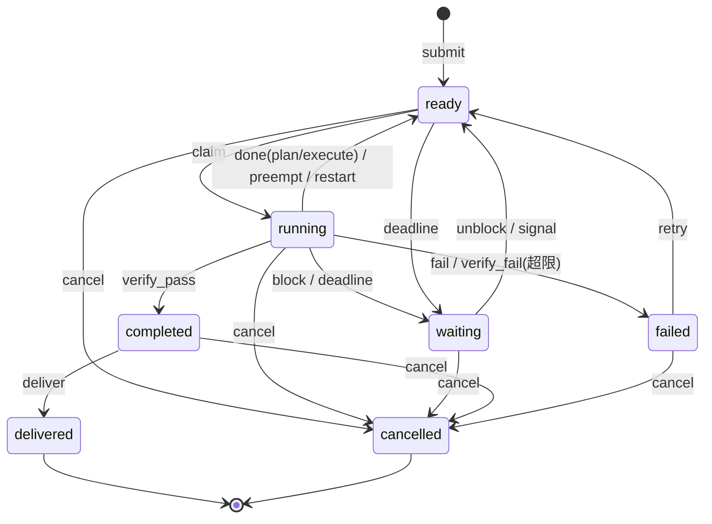

# A2A Engine

面向多 agent 协作的任务状态机：**plan → execute → verify → deliver**。
状态落在 SQLite，CLI 是唯一事实来源，重启或上下文压缩后仍能续跑。

Python 3.11+，只用标准库，核心是单文件 `engine/a2a.py`。

## 解决什么问题

聊天上下文会丢、工具调用会断、重启后没人记得任务做到哪一步。这个引擎把任务状态、事件、信号和产物路径写进数据库，让协作过程可恢复、可审计、可门禁。

- 显式状态机：`new → ready → running → waiting → completed → delivered`，非法迁移直接拒绝。
- append-only 事件流，可回放；状态变更与事件在同一事务提交。
- 阶段产物门禁：`plan.md` / `result.md` / `verify.md`，只有 `verify PASS` 才能 `deliver`。
- 返工上限、deadline、心跳、抢占、恢复、幂等 inbox。
- 人工审批：`require-approval` 只挂起任务，不写 `signals`；只有编排者在用户确认后 `emit` 才算批准。
- 安全配套：不可信文本清洗、GitHub 固定 commit SHA 读取、凭据暴露自检。

## 仓库结构

```text
engine/
  a2a.py                  # 状态机 CLI
  github_safe_read.py     # GitHub 只读访问 / 硬化 clone
  sanitize_untrusted.py   # 外部文本清洗，输出数据信封
  security_preflight.py   # 凭据、git hooks、路径自检
  test_a2a.py             # 19 个用例
  test_security.py        # 16 个用例
docs/
  PROTOCOL.md             # 协作协议 v2.2
  SECURITY.md             # 不可信内容与提示词注入防护
  engine.md               # 完整命令速查
  archive/                # 历史协议版本
```

## 快速开始

在仓库根目录执行（若 `python` 不在 PATH，换成解释器绝对路径）：

```powershell
python -m unittest discover -s engine -v

python engine/a2a.py submit --id demo-1 --name demo `
  --goal "做一件事" --acceptance "测试通过"
python engine/a2a.py claim demo-1 --stage plan --agent plan
python engine/a2a.py next
python engine/a2a.py status demo-1 --json
```

默认数据库是仓库根下的 `state.db`；`tasks/`、`inbox/`、`BOARD.md` 也相对数据库所在目录生成，因此测试库天然隔离。

## 状态机



`stage` 只前进：`plan → execute → verify → deliver`；`verify FAIL` 回到 `execute`，默认最多返工 2 轮。

## 文档

- [`docs/PROTOCOL.md`](docs/PROTOCOL.md) — 角色边界、状态机、阶段契约、审批门禁、不可信内容规则。
- [`docs/SECURITY.md`](docs/SECURITY.md) — 威胁模型、信任分级、GitHub 规则、工具用法。
- [`docs/engine.md`](docs/engine.md) — 全部命令、参数、退出码、inbox 格式。
- [`docs/archive/`](docs/archive/) — v1、v2.0、v2.1 协议原文，只读保留。

## 配置

| 变量 / 参数 | 作用 | 默认 |
|---|---|---|
| `--db PATH` | SQLite 数据库位置 | 仓库根 `state.db` |
| `A2A_ALLOWED_ROOTS` | 允许写入的根目录，多个用系统路径分隔符（Windows `;`，POSIX `:`） | 仓库根 |
| `GITHUB_READ_TOKEN` | `github_safe_read.py` 的只读 token | 无（匿名，60 次/小时） |
| `GITHUB_TOKEN` | 上面的兜底变量 | 无 |

`--db` 与 `--artifact` 必须位于允许根目录下，否则退出码 2。

## 测试

```powershell
python -m unittest discover -s engine -v
```

35 个用例全部使用仓库内 `.test-tmp/` 的隔离目录，不会碰生产数据。

## 范围说明

本仓库从作者的本地 OpenBot 工作区整理而来。发布时移除了：

- `tasks/` 下的实际任务记录（含个人项目信息）；
- `state.db` 运行数据库与会话状态；
- 本机绝对路径和本机权限基线，改为 `A2A_ALLOWED_ROOTS` 与通用模板。

协议与引擎逻辑保持原样，仅做路径可移植化调整。

## License

[MIT](LICENSE) © 2026 chornensd
