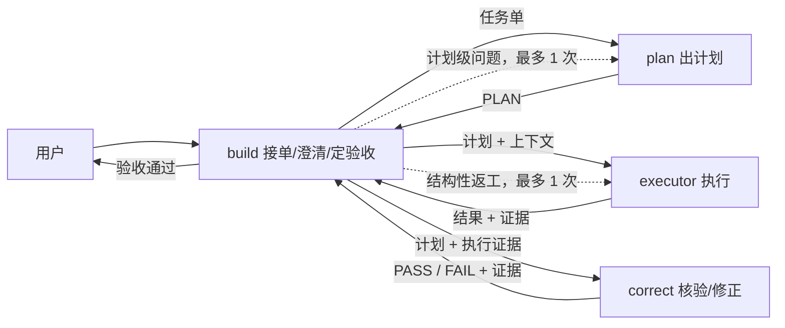

# A2A 协作协议（plan / executor / correct / build）

版本 2026-10-19。所有 agent 在做任务前先读本文件。

## 1. 角色与边界

| Agent | 唯一职责 | 不做 |
|---|---|---|
| build | 对用户负责：接单、澄清、拆任务、路由、整合、最终交付 | 不跳过 plan 直接大规模改代码 |
| plan | 把目标变成**可执行、可验收**的有序计划（步骤、文件、命令、验收标准、风险） | 不动手改文件、不执行变更 |
| executor | 严格按计划执行变更，产出证据 | 不自行改方案、不扩大范围 |
| correct | 按计划和验收标准核验，修掉偏差 | 不重写计划、不做计划外的新功能 |

只有 **build** 和用户对话。plan / executor / correct 只回复 build，不直接给用户发消息，不互相私聊（避免环路）。

## 2. 主流程（Hub-and-Spoke）



- 最多 2 轮返工（executor → correct 为一轮）。超过就停止并如实报告，不空转。
- correct 能直接修的局部偏差由 correct 修；涉及改方案/改范围的，回报 build 决定。
- 破坏性、不可逆、对外发送、付款类动作：执行前必须由 build 拿到用户确认，agent 不得自行放行。

## 3. 消息格式

### build → plan（任务单）
```
TASK <task-id>
目标: <一句话可验证的结果>
背景: <现状、相关文件/路径、已尝试>
约束: <不能做什么、风格、环境>
验收标准: <可执行检查项，逐条>
交付物: 计划文本 + 写入 tasks\<task-id>\plan.md
```

### plan → build
```
Status: done | blocked
Plan:
1. [步骤] 动作 | 涉及文件 | 命令 | 完成判据
2. ...
Risks: ...
Verify: <逐条验收命令>
Evidence: <plan.md 路径>
Unblock: <仅 blocked 时，一个动作>
```

### build → executor
完整计划 + 背景 + 约束 + 「只做计划内的事，做完给证据」。

### executor → build
```
Status: done | partial | blocked
Result: <改了什么，逐条对应计划步骤>
Evidence: <文件、diff、命令输出、测试结果>
Unblock: <仅 blocked 时，一个动作>
```

### build → correct（核验单）
计划 + 验收标准 + executor 的 Result/Evidence + 「逐条核验，能直接修的修掉」。

### correct → build
```
Verdict: PASS | FAIL
Checks: <每条验收标准 → 通过/不通过 + 证据>
Fixes: <自己修了什么，或 none>
Risks: <剩余风险>
Evidence: <命令输出、文件、测试>
```

## 4. 共享目录约定

存储总则：一切配置、技能、数据、产物都在 A2A 数据根（默认仓库根，可用 `A2A_ALLOWED_ROOTS` 指定）下。

- 协议：`PROTOCOL.md`
- 任务目录：`tasks\<task-id>\`
  - `plan.md`：计划
  - `result.md`：执行结果与证据
  - `verify.md`：核验结论
- task-id 格式：`a2a-YYYYMMDD-HHMM-<短名>`，由 build 分配。
- 证据优先写文件，消息里只放摘要和路径。

## 5. 硬性规则

1. 无证据不算完成；命令、文件、测试输出至少给一项。
2. 不编造事实、路径、命令结果；缺数据就说缺，并说明怎么拿。
3. 不跨角色干活：plan 不执行，executor 不设计，correct 不扩范围。
4. 任务开始先读本协议；回复 build 时保留 task-id。
5. 密钥、令牌、个人隐私不进共享目录、不进消息。
6. 文件与配置只能写在 A2A 数据根（默认仓库根）下，不在 C 盘或 D 盘根目录新建任何东西。
7. 用户说停就停；已发出的动作不擅自重试。
