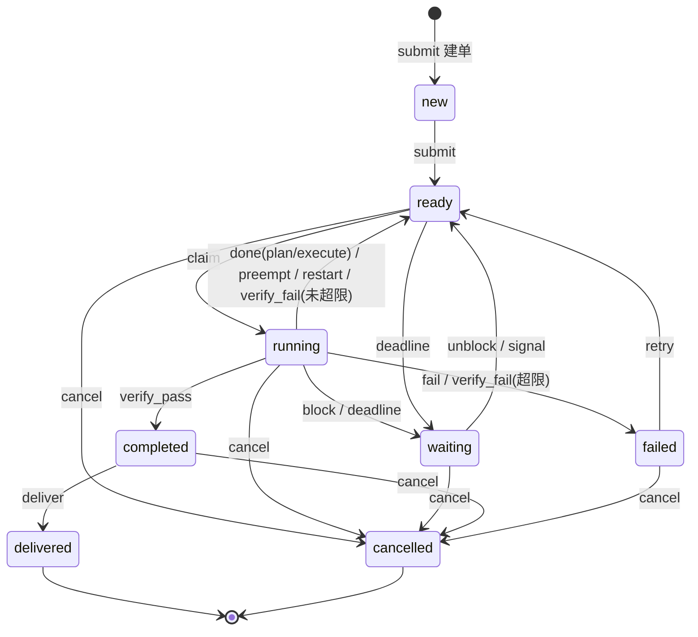

# A2A 协作协议 v2（plan / executor / correct / build）

版本 **2.1**，日期 **2026-11-03**。所有 agent 在做任务前先读本文件。

## 1. 版本与变更

v1（2026-10-19，103 行，SHA256 `F88EB7EB…DB4DB7`）原文归档在
`docs/archive/PROTOCOL-2026-10-19.md`，不删除、不改写。

v2 变更：

- 任务状态从聊天上下文迁移到 SQLite（`state.db`）+ CLI，重启/上下文压缩后可恢复。
- 增加显式状态机与迁移白名单：非法迁移退出码 2，任务与事件都不变。
- 增加 append-only 事件、持久化信号、心跳、超时、抢占、inbox 幂等。
- 增加阶段契约与产物门禁：`plan.md` / `result.md` / `verify.md`；PASS 才能 `deliver`。
- 保留 v1 的角色边界、2 轮返工、只有 build 对用户说话、危险动作先批准。

v2.1（2026-11-03）：补充可选红队 `doubter` 的边界——状态机外、无否决权、不写状态。

引擎与命令速查：`docs/engine.md`。

## 2. 角色与边界

| Agent | 唯一职责 | 不做 |
|---|---|---|
| build | 对用户负责：接单、澄清、拆任务、`claim`、路由、整合、`deliver` | 不跳过 plan 直接大规模改代码 |
| plan | 把目标变成可执行、可验收的有序计划 | 不动手改文件、不执行变更 |
| executor | 严格按计划执行变更，产出证据 | 不自行改方案、不扩大范围 |
| correct | 按计划和验收标准核验，修掉偏差 | 不重写计划、不做计划外的新功能 |

- 可选红队 `doubter` **不属于本状态机**：只在 build 邀请时，对计划或结果提最多 3 条带证据的
  质疑，供 build 决策；不 `claim`、不产出阶段文件、不参与 `deliver` 门禁，也没有否决权。
- 只有 **build** 和用户对话；plan / executor / correct / doubter 只回复 build，不互相私聊。
- 只有 build 执行 `deliver`；`claim --stage deliver` 一律拒绝。
- build 在派单前 `claim`（D4），agent 不重复 claim，只做 `done/verify/fail/block`。
- 消息中始终带 task-id；事实以 CLI/DB 为准，聊天只做摘要。

## 3. 事实来源

1. **`state.db`**：任务、事件、信号。
2. **CLI**：`status / list / events / next / signals / stats` 是唯一事实来源。
3. **产物文件**：`tasks/<task-id>/plan.md|result.md|verify.md` 是交付依据；DB 的
   `artifacts` 存绝对路径，`deliver` 前重新 `stat`。
4. 聊天记录、记忆、消息摘要都不是状态来源。每个新回合先 `sweep → list → next`；
   **只有 OpenBot 重启/上下文丢失/确认 agent 已停**时才 `recover`，否则会把仍在工作的
   `running` 任务重置为 `ready`，造成重复派单。

## 4. 状态机与迁移表

`state`：`new | ready | running | waiting | completed | delivered | failed | cancelled`
`stage`：`plan | execute | verify | deliver`

- `new` 只在 `submit` 事务内短暂存在，提交后必为 `ready`。
- `TERMINAL = {delivered, failed, cancelled}`；`completed` 仍可 `cancel`。
- `stage` 只前进：`plan → execute → verify → deliver`；verify FAIL 回 `execute`。



### 4.1 迁移白名单（唯一合法组合）

| # | 当前 state | 事件 kind | 下一 state | stage 变化 | 守卫 / 副作用 |
|---|---|---|---|---|---|
| 1 | new | submit | ready | plan | acceptance ≥1；同一事务写入任务+事件 |
| 2 | ready | claim | running | 不变 | `--stage` 等于当前 stage；agent 非空；该 agent 无其他 running（`--force` 除外）；写 assignee/last_heartbeat |
| 3 | running | done | ready | plan→execute 或 execute→verify | stage 匹配且 ∈{plan,execute}；产物存在且非空；复制为规范产物 |
| 4 | running | verify_pass | completed | deliver | stage=verify；verify 产物存在非空；verdict=PASS |
| 5 | running | verify_fail | ready | execute | `rework_count+1 <= max_rework`；verdict=FAIL；清 assignee |
| 6 | running | verify_fail | failed | 不变 | `rework_count+1 > max_rework`；额外记 `fail`（rework limit） |
| 7 | running | fail | failed | 不变 | `--error` 必填 |
| 8 | failed | retry | ready | 不变 | `attempts < max_retries`；attempts+1；清 assignee/waiting_for；记 retry |
| 9 | running | block | waiting | 不变 | `--wait` 非空；信号已存在则只剔除，不阻塞 |
| 10 | waiting | unblock | ready | 不变 | waiting_for 清空；否则保持 waiting（部分唤醒） |
| 11 | waiting | signal | ready | 不变 | emit 命中且清空 waiting_for；与 unblock 同事务 |
| 12 | running | preempt | ready | 不变 | 保留 checkpoint；清 assignee；记 preempt |
| 13 | running | restart | ready | 不变 | 仅 recover；attempts+1；保留 checkpoint；记 restart |
| 14 | ready | deadline | waiting | 不变 | deadline 到期；waiting_for 追加 `deadline:<id>`；记 deadline |
| 15 | running | deadline | waiting | 不变 | 同上 |
| 16 | waiting | deadline | waiting | 不变 | 追加 deadline 信号，不重复记 |
| 17 | completed | deliver | delivered | 不变 | verdict=PASS 且 verify 产物存在非空；写 delivered_at |
| 18 | 任意非终态 | cancel | cancelled | 不变 | 清 assignee/waiting_for；记 cancel |
| — | 其他组合 | — | 拒绝 | — | 退出码 2，状态/事件均不变 |

`done` 在 stage=verify 一律拒绝，必须走 `verify`。`claim --stage deliver` 拒绝。
`retry` 是 `fail` 在 `attempts < max_retries` 时写入的内部事件，没有独立 `retry` 命令；
一旦进入 `failed`，只能 `cancel` 或换新 task-id 重新 `submit`。

## 5. 阶段契约

| stage | 执行者 | 进入条件 | 必须产物 | 结束命令 | 结束后的 stage |
|---|---|---|---|---|---|
| plan | plan | submit 后 ready | `tasks/<id>/plan.md` | `done <id> --stage plan --artifact <plan.md>` | execute |
| execute | executor | plan done 后 ready | `tasks/<id>/result.md` | `done <id> --stage execute --artifact <result.md>` | verify |
| verify | correct | execute done 后 ready | `tasks/<id>/verify.md` | `verify <id> --verdict PASS\|FAIL --artifact <verify.md>` | deliver（PASS）或 execute（FAIL） |
| deliver | build | verify PASS 后 completed | 已有 verify.md | `deliver <id> --summary ...` | delivered |

- 产物必须存在、`strip()` 非空；引擎复制并规范化为固定文件名。
- `deliver` 只硬性要求 PASS + verify 产物；缺 `result.md` 仅在输出 warning，不阻断。
- verify FAIL 默认最多 2 轮返工（`--max-rework 2`），超限 `failed` 并记录原因。

## 6. 消息信封

build → agent（派单）：

```
TASK: <task-id>
STAGE: plan | execute | verify
STATE: <CLI 当前 state>
ASSIGNEE: <agent 角色名>
ARTIFACT: <必须写入/读取的绝对路径>
EVIDENCE: <已有证据、上游产物路径、相关文件>
UNBLOCK: <仅 blocked 时一个动作>

目标: <一句话可验证结果>
验收: <逐条验收标准>
约束: <不能做什么、环境、路径>
完成: 写 <artifact> 后执行 <done/verify 命令>
```

agent → build（回报）：

```
TASK: <task-id>
STAGE: <当前 stage>
STATE: done | blocked | failed
ASSIGNEE: <角色名>
ARTIFACT: <产物绝对路径>
EVIDENCE: <命令、测试、文件>
UNBLOCK: <仅 blocked 时一个动作>
```

- 每条消息自包含（队友看不到 build 的对话与记忆），只带完成所需信息。
- 结果按 `Status / Result / Evidence / Unblock`；核验按 `Verdict / Checks / Fixes / Risks / Evidence`。
- 缺关键项时 build 追问一次，不替 agent 补。

## 7. 标准流程

build 每个新回合（示例以仓库根为工作目录；若 `python` 不在 PATH，改用解释器绝对路径）：

```powershell
$py = 'python'
$a  = 'engine/a2a.py'
& $py $a sweep --json
& $py $a list --json
& $py $a next
```

仅在 OpenBot 重启、上下文丢失、或确认 agent 已停后，先执行 `recover` 再 `sweep/list`：

```powershell
& $py $a recover --json   # running -> ready, attempts+1
```

若 `list` 显示 `running` 且 `openbot.list_agents` 显示对应 agent 仍在 `working`，
不要 `recover`；先等回报或用 `heartbeat`/`sweep` 判断。

单任务主循环：

1. `submit`：目标 + ≥1 条验收，state=ready/stage=plan。
2. `next` 看下一位 agent/产物/命令。
3. build `claim <id> --stage <stage> --agent <role>`。
4. 发 STAGE 消息（任务信封）。
5. agent 写产物并执行 `done` / `verify` / `fail` / `block`。
6. build 用 `status` / `events` 核对，再进入下一 stage。
7. verify PASS → `completed`；build `deliver` → `delivered`。
8. 向用户交付结论 + 证据，标注 confirmed / likely / unverified。

已有同 task-id 不得重复 `submit`；先 `status <id>` 判断续跑还是取消。

## 8. 异常路径

| 情况 | 命令 | 结果 |
|---|---|---|
| 等待用户批准/外部依赖 | `block <id> --wait approval:<id>:<action> --reason ...` | waiting；`emit` 后 ready |
| 危险动作审批 | `require-approval <id> --action ... --reason ...` | waiting，事件 `approval_required` |
| 执行失败 | `fail <id> --error ...` | failed；若 `attempts < max_retries` 自动 retry→ready |
| 核验不通过 | `verify <id> --verdict FAIL ...` | ready/execute，`rework_count+1` |
| 返工超限 | 同上（超过 max_rework） | failed + `fail` 事件（rework limit） |
| 用户插入更高优先任务 | `preempt <id> --reason ...` | ready，保留 checkpoint/stage |
| 用户取消/说停 | `cancel <id> --reason ...` | cancelled（终态） |
| deadline 到期 | `sweep` 自动 | waiting + `deadline:<id>`；`extend` 恢复 |
| agent 卡死 | `sweep --stale-minutes N` | running→ready，事件 `preempt/reason=stale` |
| 批量注入 | `pump` | 处理 `inbox/*.json`，失败进 `failed/` |

### 8.1 Inbox 幂等

`ROOT/inbox/*.json`，动作：`submit|emit|done|fail|verify|block|cancel`。
幂等键 = `inbox:<filename>:<sha256>`，写入 `events.idem_key` 唯一索引。
成功移入 `inbox/processed/`，失败移入 `inbox/failed/`，同一文件只执行一次；
坏 JSON 不导致 `pump` 非零退出，另记 `inbox_failed` 事件。

## 9. 恢复、超时与抢占

- **recover**：所有 running→ready，stage 不变，attempts+1，清 assignee，保留
  checkpoint/waiting_for，事件 `restart`；waiting 不动；重复执行幂等。
- **sweep**：先处理 deadline（非终态且非 completed；已含 `deadline:<id>` 跳过），
  再处理 stale（`last_heartbeat < now - stale_minutes*60` 的 running→ready，
  事件 `preempt/reason=stale`）。
- **heartbeat**：running 任务定期刷新 `last_heartbeat`，不写事件。预计超过 10 分钟的
  stage，build 在派单消息里要求 agent 每 10 分钟执行 `heartbeat <id>`；否则
  `sweep --stale-minutes` 会把仍在工作的任务误判为卡死并转 `ready`。
- **deadline**：到期转 waiting，不静默失败；build 用 `extend` 设新期限或 `cancel`。
- **preempt**：主动抢占，保留 checkpoint 和 stage，事件 `preempt`。
- **next**：`waiting_for` 含 `deadline:<id>` 时给出 `extend` 命令；不要 `emit deadline:<id>`，
  否则 sweep 会再次把任务转回 waiting。
- `attempts` 语义：失败重试/重启恢复次数；`claim` 不增加。

## 10. 审批门禁

1. executor 遇到破坏性、不可逆、对外发送、付款动作，先执行
   `require-approval <id> --action "<动作>" --reason "<原因>"`。
2. `require-approval` 只写 `approval_required` 事件，并把 `approval:<task-id>:<slug>`
   放进 `waiting_for`，state→waiting；**不写 signals 表**。pending ≠ approved。
3. **只有 build** 在用户明确确认后执行 `emit approval:<task-id>:<slug>`；`emit` 才写
   `signals` 并唤醒 waiting→ready。
4. executor 不得自行 `emit` 审批信号；事件的 `actor` 会留痕。
5. 合法预批准：若 `signals` 已存在该信号（build 事先 emit），不转 waiting，记
   `approval_precheck`，返回 approved=true，保持 running。
6. 同一任务/动作重复请求但没有 emit：`signals` 仍无该信号，必须继续 blocked，
   绝不返回 approved=true。`recover` 不处理 waiting；重复请求前需先 `unblock`
   （或 cancel）再 claim；直接对 waiting 重复 `require-approval` 会因 state 门禁退出 2，
   任务仍保持 waiting。
7. `block --wait approval:<id>:<slug>` 与 pending 请求同语义：请求前 `signals` 无记录
   就阻塞，`emit` 后才唤醒。

## 11. CLI 速查

入口（示例以仓库根为工作目录；若 `python` 不在 PATH，改用解释器绝对路径）：

```powershell
$py = 'python'
$a  = 'engine/a2a.py'
& $py $a <command> ...
```

完整命令、示例、inbox 格式见 `docs/engine.md`。状态变更命令：
`submit, claim, done, verify, deliver, fail, block, unblock, emit, require-approval,
preempt, recover, sweep, heartbeat, checkpoint, extend, cancel, pump`。
读命令：`status, list, next, events, signals, stats, wait, watch, board`。

退出码：`0 成功；1 未找到/wait failed；2 门禁或非法迁移/重复 id/参数错误（状态不变）；3 wait 超时`。

所有状态变更输出 JSON，含 `ok, task_id, state, stage, next`；失败 JSON 到 stderr。

## 12. 证据与交付

- 无证据不算完成：命令、文件、测试输出至少一项。
- 每阶段产物落盘：`plan.md`、`result.md`、`verify.md`，路径带 task-id。
- `deliver` 硬门禁：state=completed、stage=deliver、verdict=PASS、verify 产物重新
  `stat` 非空；否则退出 2，状态不变。
- 交付时给用户结论 + 绝对路径 + 证据摘要；未验证部分明确标注。

## 13. 两轮返工

- `max_rework` 默认 2；`verify FAIL` 使 `rework_count+1`。
- 未超限：state=ready、stage=execute，回 executor 重做。
- 超限：state=failed，事件 `verify_fail` + `fail`（rework limit），build 如实报告，
  不空转、不伪造 PASS。

## 14. 历史任务

v1 的 `tasks/<task-id>/` 目录保留，不回填 DB、不删除、不覆盖。新任务从 v2 开始，
状态以 `state.db` 为准；旧任务若需继续，按新 task-id 重新 `submit` 并引用旧产物。

## 15. 硬性规则

1. 无证据不算完成；命令、文件、测试输出至少给一项。
2. 不编造事实、路径、命令结果；缺数据就说缺，并说明怎么拿。
3. 不跨角色干活：plan 不执行，executor 不设计，correct 不扩范围。
4. 任务开始先读本协议；回复 build 时保留 task-id。
5. 密钥、令牌、个人隐私不进共享目录、不进消息、不进 DB。
6. 文件与配置只能写在 A2A 数据根（默认仓库根，可用 `A2A_ALLOWED_ROOTS` 指定）下。
7. 用户说停就停：`cancel`/`preempt` 相关任务，关闭等待，不擅自重试。
8. 只有 build 对用户说话；agent 之间不私聊。
9. 破坏性/对外/付款动作必须先 `require-approval`，用户确认后由 build `emit`。
10. 不重复派单：派单前看 `status`/`list`，同一 task-id 不重复 `submit`。
